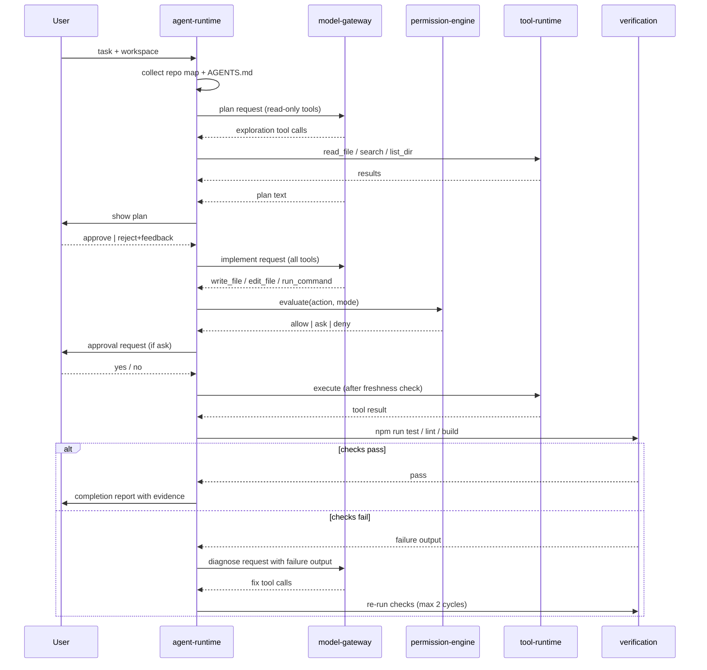
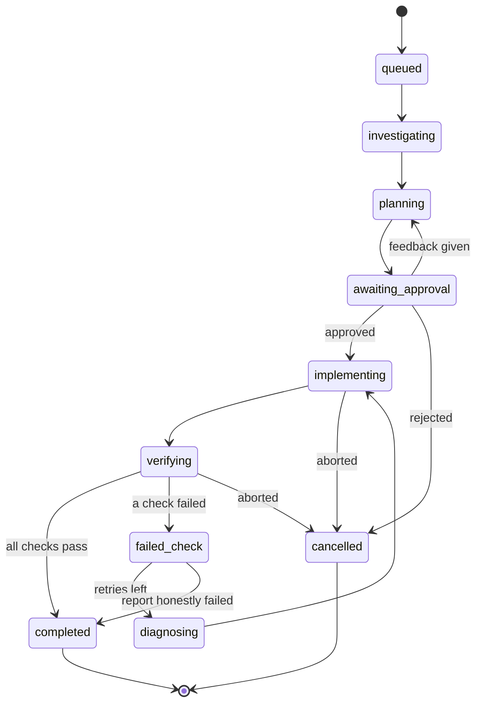
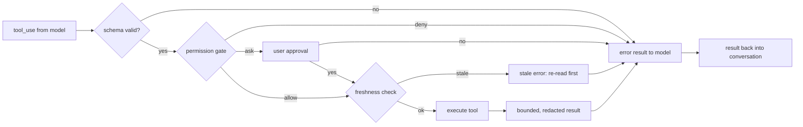
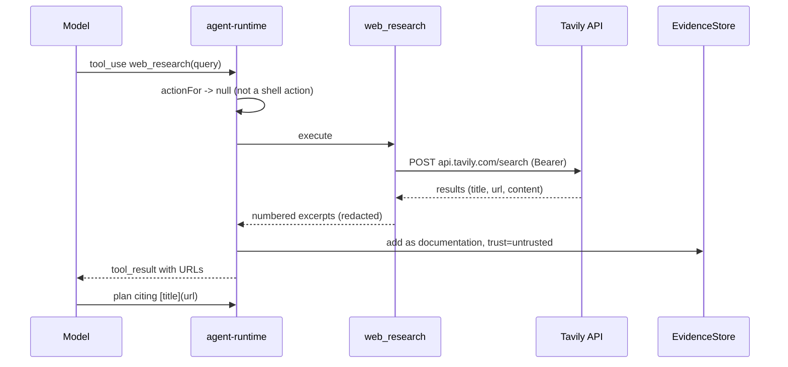
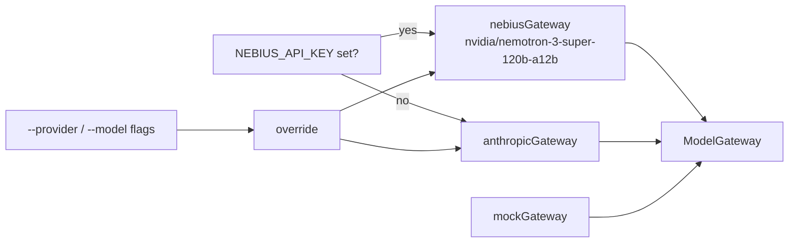
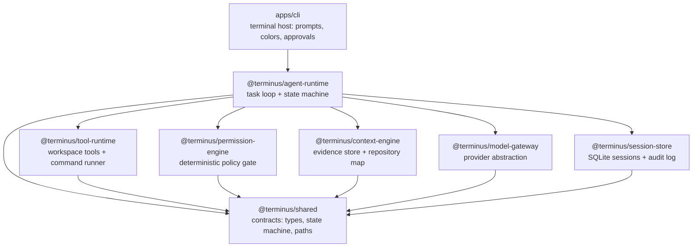

# TERMINUS

**Where instructions become execution.**

An autonomous coding agent that works inside your repository: it researches
unfamiliar technology with cited web sources, maps the codebase, plans the
change, asks for your approval, edits files through a permission gate, runs
the project's own checks, and reports completion from evidence rather than
prose. Powered by NVIDIA Nemotron models on Nebius Token Factory.

```
research → map → plan → approve → edit → run checks → (fail → diagnose → fix) → report
```

## Table of contents

- [Install](#install)
- [Quick start (from source)](#quick-start-from-source)
- [How Nemotron powers TERMINUS](#how-nemotron-powers-terminus)
- [Deep research with citations](#deep-research-with-citations)
- [How it works — agentic flow](#how-it-works--agentic-flow)
- [Harness & permission gate](#harness--permission-gate)
- [What makes it reliable](#what-makes-it-reliable)
- [Agent Skills](#agent-skills-owasp-security-uiux-api-design)
- [CLI](#cli)
- [Demo](#demo)
- [Architecture](#architecture)
- [Commands](#commands)
- [Documentation](#documentation)
- [License](#license)


One command, either package manager (Node 22.5+; bun works too):

```bash
npm install -g terminus-agent     # provides the `terminus` command
# or
bun install -g terminus-agent
```

Put your keys once, and terminus works from **any** project folder:

```bash
mkdir -p ~/.terminus && cat > ~/.terminus/.env <<'EOF'
NEBIUS_API_KEY=...      # tokenfactory.nebius.com (code NEBIUS-DEVPOST-GLOBAL26)
TAVILY_API_KEY=tvly-... # optional deep research
EOF
```

Then run it from any project folder:

```bash
terminus "add input validation to the signup form"
terminus                                     # interactive session: chat + tasks
terminus --mode plan "structure the api client"   # research and plan, no edits
```

## Quick start (from source)

```bash
bun install
cp .env.example .env        # or use ~/.terminus/.env as above

bun run terminus "add input validation to the signup form"
bun run terminus            # interactive session REPL
bun run terminus --mode plan "how should we structure the API client?"
bun run terminus --mode ask  "what does src/billing do?"
```

Requires [Bun](https://bun.sh) 1.2+ for source runs; the published package
needs Node 22.5+.

## How Nemotron powers TERMINUS

TERMINUS talks to Nebius Token Factory's OpenAI-compatible API. The default
model is **`nvidia/nemotron-3-super-120b-a12b`** (256K context): it drives
planning, structured tool use, implementation, and debugging in the same
agent loop. Every request streams; token usage is accumulated per task and
shown in the completion report.

| Nemotron model | Intended role in TERMINUS | Status |
|---|---|---|
| `nemotron-3-super-120b-a12b` | main coding agent: plan, tool calls, implement, debug | default |
| `Nemotron-3.5-Lightning` | fast, cheap turns for routine analysis | roadmap |
| `nemotron-3-ultra-550b-a55b` | hardest architectural reasoning | roadmap |

Provider selection is a single seam (`selectGateway`): `NEBIUS_API_KEY`
selects Nemotron, with Anthropic available via `--provider anthropic`.
Switching models is a flag or an environment variable — the harness (tools,
permissions, context, verification) is model-independent.

```bash
bun run terminus --model nvidia/nemotron-3-super-120b-a12b "task..."
```

## Deep research with citations

With `TAVILY_API_KEY` set, the agent can call `web_research` before it
codes: it searches official documentation, keeps titles/URLs/excerpts as
**untrusted evidence**, and must cite sources as `[title](url)` in its plan.
Search results never reach the permission engine — they cannot authorize a
command or change policy.

## How it works — agentic flow

### Task loop



### State machine

Every task has exactly one state; transitions are validated, illegal jumps
throw. Persisted to the session store on every change.



### Tool execution pipeline



### Research flow (Tavily)

`web_research` is a read-tier tool: visible while planning, never maps to a
shell action, and its output is stored as **untrusted** evidence with URLs
preserved.



## Harness & permission gate

The harness (tools, permissions, context, verification) is model-independent.
The gate evaluates the **proposed action only**, never conversation text.

Order: hard-deny regex → fast-path allowlist → risk-tier classification →
user approval. Session-based `[a]lways` remembers per-session, never global.
Local policy (`~/.terminus/policy.local.json`) can only add restrictions.

### Model gateway selection



Adding another provider means implementing one function. Nothing else in the
runtime changes.

### Package layering



Rules: `shared` depends on nothing above it; host apps depend on the runtime,
never the reverse; tools never know which model produced their input.

## What makes it reliable

| Capability | How TERMINUS does it |
|---|---|
| Context engineering | repository map, evidence store with hashes, stale-write guard — files edited outside the session are re-read, never clobbered |
| Verification loop | runs the project's own `test/typecheck/lint/build` scripts; failures are fed back for diagnosis (2 cycles); completion requires passing checks |
| Safety | deterministic policy gate: hard-deny → allowlist → mode tiers → explicit approval; local policy can only add deny rules |
| Evidence-based reports | changed files, commands run, per-check pass/fail, token usage — from observed results, never from prose |
| Persistent sessions | SQLite audit log; `--resume <id>` continues with an earlier session's honest context |

## Agent Skills (OWASP Security, UI/UX, API Design)

TERMINUS natively discovers and applies reusable **Agent Skills** (`SKILL.md`) located in `skills/` or `~/.terminus/skills/`. The Context Engine automatically matches your task intent and injects domain-specific Standard Operating Procedures (SOPs) into Layer 2 of Context:

- **Security**: `secure-code-review` — Full OWASP Top 10 systematic vulnerability review with vulnerable vs fixed examples.
- **Frontend / UI/UX**: `design-system-builder`, `landing-page-scaffold`, `tasteful-ui` — Token extraction, conversion landing pages, and polished aesthetics.
- **Backend**: `api-shape-explorer`, `route-to-openapi` — "Design it twice" API exploration and OpenAPI 3.0 generation.
- **Skill Development**: `skill-builder` — Meta-skill to author, test, and audit custom skills.

👉 **Read the full [Beginner's Skills Guide](docs/skills-guide.md)** for step-by-step instructions and copy-paste examples.

## CLI

```
terminus "task"              run a task (plan → approve → implement → verify)
terminus                     interactive REPL; /clear /sessions /quit
--mode ask|plan|act|auto     default act (plan first, then edit)
--yes                        approve low-risk actions without prompting
--report json                machine-readable CompletionReport on stdout
--sessions / --resume <id>   list sessions / continue with prior context
--timeout <sec>              per-command timeout       (also config.json)
--provider nebius|anthropic  backend override          (also config.json)
```

Defaults live in `~/.terminus/config.json` and per-project
`.terminus/config.json` (project wins). Approval prompts accept `[a]lways`
to remember a command for the current session only.

## Demo

A fixture project with a failing test ships in `examples/demo-project`:

```bash
bun run terminus --dir examples/demo-project \
  "add formatForTimezone(iso, timeZone) so the test passes"
```

The same flow runs offline in CI (`evals/demo.test.ts`): research → cited
plan → wrong implementation → real test failure → diagnosis → fix → passing
checks, asserting every state transition along the way.

## Architecture

```
apps/cli          terminal host: REPL, approvals, config, reports
packages/
  agent-runtime   the loop: plan → approve → act → verify (+ session continuity)
  model-gateway   ModelGateway seam: nebius (nemotron), anthropic, scripted mock
  context-engine  evidence store, repository map, freshness tracking
  permission-engine  deterministic policy gate (deny → allowlist → ask)
  tool-runtime    workspace tools, bounded command runner, secret redaction
  research        tavily client + web_research tool (untrusted cited evidence)
  session-store   local SQLite sessions + append-only audit log
  shared          contracts: evidence, task states, tools, events
evals/            safety matrix + end-to-end demo narrative
examples/         demo fixture project
docs/             architecture, security model, context engineering
```

## Commands

```bash
bun test            # 95 tests: unit, integration, safety evals, demo e2e
bun run typecheck   # strict TypeScript across all packages
bun run lint        # biome
bun scripts/spike-toolcalls.ts   # live check: nemotron returns tool_calls
```

## Documentation

- [Architecture](docs/architecture.md) — components, loops, state machine, gateway selection
- [Security model](docs/security-model.md) — gate ordering, tiers, network tools, threat notes
- [Context engineering](docs/context-engineering.md) — evidence, freshness, selection

## License

MIT
