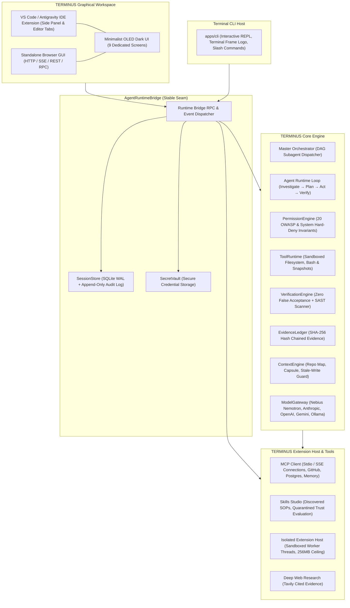
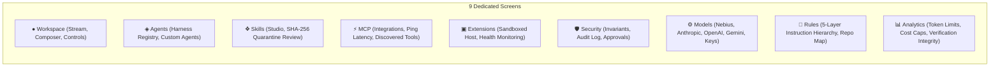
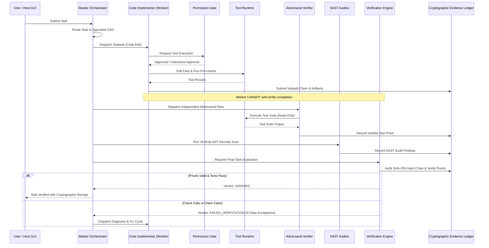
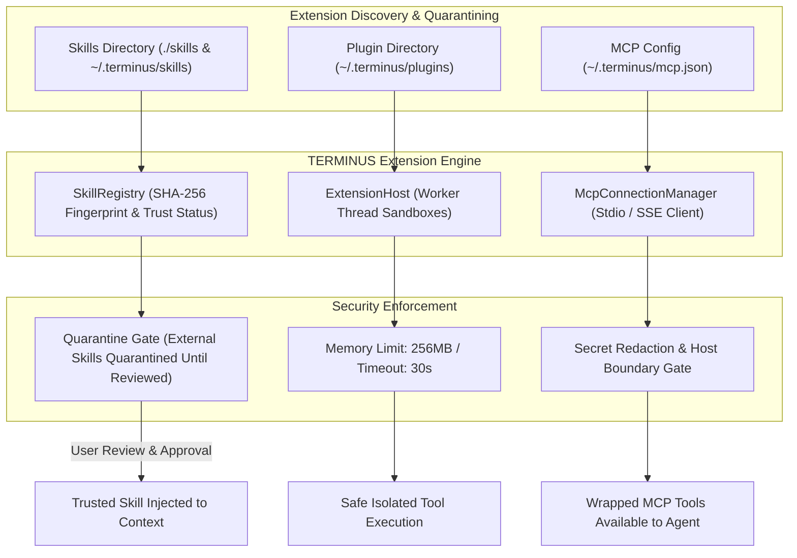
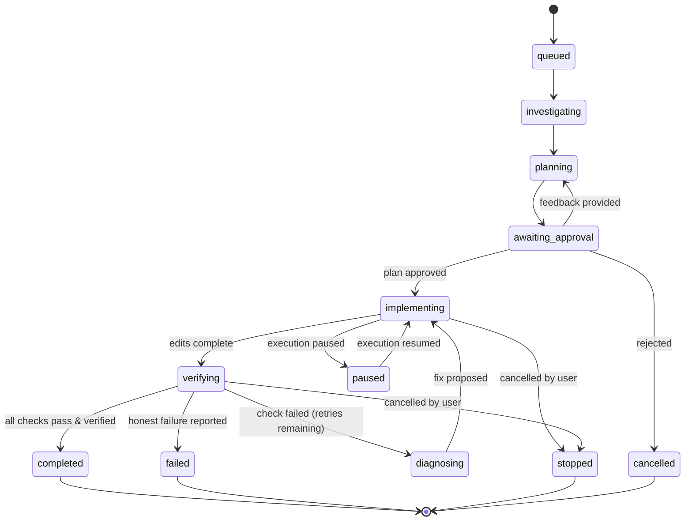
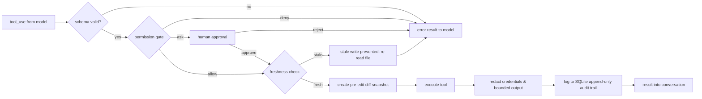

# TERMINUS

<p align="center">
  <pre align="center">
  ┌──      ──┐  TERMINUS v0.3.2
  │   ████   │  Autonomous AI Software Engineering Workspace
  │    ██    │  Runtime: Bun/Node (darwin/arm64)
  │    ██  ■ │  Evidence Ledger · Skills Studio · MCP Client · Plugin Host
  └──      ──┘
  </pre>
</p>

<p align="center">
  <strong>Where instructions become verified software engineering execution.</strong>
</p>

<p align="center">
  <a href="#table-of-contents"></a>
  <a href="#table-of-contents"></a>
  <a href="#table-of-contents"></a>
  <a href="#table-of-contents"></a>
</p>

---

## Table of contents

- [Overview](#overview)
- [System Architecture](#system-architecture)
- [Graphical Workspace & IDE Extension](#graphical-workspace--ide-extension)
- [Multi-Agent Verified Orchestration](#multi-agent-verified-orchestration)
- [Ecosystem: Skills, MCP & Plugins](#ecosystem-skills-mcp--plugins)
- [How It Works — Agentic Flow](#how-it-works--agentic-flow)
- [Security & Invariant Hard-Deny Gate](#security--invariant-hard-deny-gate)
- [CLI Reference & REPL](#cli-reference--repl)
- [Quick Start](#quick-start)
- [Test Suite & Verification](#test-suite--verification)
- [License](#license)

---

## Overview

**TERMINUS** is an extensible, autonomous AI software engineering workspace. It combines a deterministic agent loop with multi-agent orchestration, an append-only cryptographic evidence ledger, Model Context Protocol (MCP) tool client, isolated plugin extension host, and a minimalist OLED dark monochrome graphical interface.

### Guiding Principles

1. **The User Customizes the Agent Through Extensions, Not by Modifying Its Core**: Add capabilities via skills, MCP servers, and isolated plugins without touching execution engine internals.
2. **Evidence Over Claims**: An agent cannot self-certify its own work. Completion requires independent dynamic test validation, static AST checks, and SHA-256 evidence chain verification (**Zero False Acceptance**).
3. **Stable Runtime Separation**: The GUI and CLI communicate with the agent engine through a documented, typed `AgentRuntimeBridge`.

---

## System Architecture



### Core Package Layering

| Package | Responsibility |
|---|---|
| [`apps/vscode`](file:///Users/sahil/Desktop/HACKATHON/TERMINUS/apps/vscode) | VS Code / Antigravity IDE Extension with Activity Bar, side panel webview, and full editor panels |
| [`apps/cli`](file:///Users/sahil/Desktop/HACKATHON/TERMINUS/apps/cli) | Terminal interface with Terminal Frame logo UI, interactive REPL, streaming status, and slash commands |
| [`packages/workspace-ui`](file:///Users/sahil/Desktop/HACKATHON/TERMINUS/packages/workspace-ui) | Minimal OLED dark workspace interface with 9 views and live streaming event cards |
| [`packages/runtime-bridge`](file:///Users/sahil/Desktop/HACKATHON/TERMINUS/packages/runtime-bridge) | Typed RPC bridge, SSE streaming server, and event bus isolating UI from agent internals |
| [`packages/agent-runtime`](file:///Users/sahil/Desktop/HACKATHON/TERMINUS/packages/agent-runtime) | Multi-agent DAG orchestrator, OO-Harness contracts, execution loop, and verification state machine |
| [`packages/mcp-client`](file:///Users/sahil/Desktop/HACKATHON/TERMINUS/packages/mcp-client) | Model Context Protocol client managing stdio/SSE server connections, pings, and discovered tools |
| [`packages/extension-host`](file:///Users/sahil/Desktop/HACKATHON/TERMINUS/packages/extension-host) | Worker thread isolation sandbox enforcing 256MB memory boundaries and 30s timeouts |
| [`packages/permission-engine`](file:///Users/sahil/Desktop/HACKATHON/TERMINUS/packages/permission-engine) | Policy gate enforcing 20 hard-deny rules, command risk tiers, and interactive approval flows |
| [`packages/context-engine`](file:///Users/sahil/Desktop/HACKATHON/TERMINUS/packages/context-engine) | Repository mapping, context capsules, compaction, and skills catalog |
| [`packages/model-gateway`](file:///Users/sahil/Desktop/HACKATHON/TERMINUS/packages/model-gateway) | Provider abstraction for NVIDIA Nemotron (Nebius), Anthropic Claude, OpenAI, Gemini, and Ollama |
| [`packages/tool-runtime`](file:///Users/sahil/Desktop/HACKATHON/TERMINUS/packages/tool-runtime) | Workspace filesystem tools, pre-edit diff snapshots, selective rollback, and secret redaction |
| [`packages/session-store`](file:///Users/sahil/Desktop/HACKATHON/TERMINUS/packages/session-store) | Local SQLite persistence, checkpoints, and append-only permission audit logs |

---

## Graphical Workspace & IDE Extension

TERMINUS provides a first-class graphical workspace built around a minimal dark OLED monochrome visual language:

- **True Black Canvas** (`#000000`) and deep surfaces (`#09090b`, `#121215`, `#1c1c21`).
- **Zero Distracting Neons or Glows**: Pure white (`#f4f4f5`) and stone gray (`#a1a1aa`, `#71717a`) typography.
- **Ultra-Responsive**: Automatically reflows from narrow IDE sidebars (200px–350px) to full 4K workstation monitors.
- **Top Segmented Tab Strip**: Instant 1-click access to all 9 application destinations at any viewport width.



### Workspace Screen & Task Inspector

1. **Active Execution Controls**:
   - **Pause / Resume**: Non-blocking runtime pause at safe execution boundaries.
   - **Stop**: Hard cancellation aborting active subagents, child processes, and scheduled tool executions.
   - **Session Switcher**: Switch between concurrent sessions or mint new ones.
2. **Conversation & Execution Stream**:
   - Progress thoughts, structured plan cards with collapsible phases, and live tool invocation cards.
   - Interactive human approval requests with `[Approve Once]`, `[Always for Session]`, and `[Reject]`.
   - Unified diff preview with pre-edit snapshots and 1-click rollback.
3. **Collapsible Task Inspector Drawer**:
   - **Verdict**: Cryptographic evidence ledger state, SHA-256 hash chains, and zero false acceptance validation.
   - **Diff**: Line-by-line file changes before writing to disk.
   - **Plan**: Structured DAG milestones and approval checkpoints.
   - **Agents**: Active worker harnesses and assignments.
   - **Files**: Repository map tree and context items.

---

## Multi-Agent Verified Orchestration



### OO-Harness Specialist Profiles

TERMINUS uses object-oriented harness contracts to enforce strict capability boundaries:

| Specialist Agent | Responsibility | Filesystem Permission | Shell Permission | Self-Certification |
|---|---|---|---|---|
| **Primary Architect** | High-level decomposition & DAG routing | Workspace read-only | Sandboxed | ❌ Forbidden |
| **Code Implementer** | Surgical edits & local check runs | Workspace read/write | Sandboxed | ❌ Forbidden |
| **Adversarial Verifier** | Independent test suite execution | Workspace read-only | Sandboxed | ❌ Forbidden |
| **SAST Auditor** | AST inspection for injections & secret leaks | Workspace read-only | Denied | ❌ Forbidden |
| **Deep Researcher** | Web documentation & cited research | Workspace read-only | Denied | ❌ Forbidden |
| **VerificationEngine** | Final arbiter verifying the evidence chain | Internal only | Internal only | ✅ Authoritative |

---

## Ecosystem: Skills, MCP & Plugins



### Model Context Protocol (MCP) Client
Connects to standard MCP servers over `stdio` and `sse` transports with automatic latency tracking, health monitoring, and tool discovery:
- **Built-in presets**: GitHub MCP, PostgreSQL Inspector, Linear Issues, Playwright Browser Automation, Slack Connector.
- **CLI Commands**: `terminus --mcp`, `terminus --test-mcp <server>`.
- **REPL Command**: `/mcp`.

### Skills Studio
Supports reusable `SKILL.md` documents across `skills/` and `~/.terminus/skills/`. External skills are quarantined upon discovery until validated by SHA-256 fingerprinting:
- **CLI Commands**: `terminus --skills`, `terminus --approve-skill <name>`.
- **REPL Command**: `/skills`.

### Sandboxed Extension Host
Executes third-party plugins inside dedicated Bun/Node Worker Threads with isolated memory (256MB) and execution timeouts (30s), completely preventing plugins from corrupting agent state:
- **CLI Command**: `terminus --extensions`.
- **REPL Command**: `/extensions`.

---

## How It Works — Agentic Flow

### State Machine Lifecycle



### Tool Execution & Freshness Pipeline



---

## Security & Invariant Hard-Deny Gate

TERMINUS operates under a defense-in-depth security model where **all actions pass through a deterministic permission gate** before touching disk or executing shell commands:

1. **Level 1 — Safety Invariants (Hard-Deny)**:
   - Prohibits reading or exfiltrating SSH keys (`~/.ssh`, `id_rsa`, `id_ed25519`).
   - Prohibits destructive git commands (`push --force`, `reset --hard HEAD~`).
   - Prohibits credential dumping (`/etc/shadow`, `.env` exports).
   - Prohibits unverified worker self-certifications.
2. **Level 2 — Fast-Path Allowlist**:
   - Safe read-only inspection commands (`git status`, `git diff`, `ls`, `grep`) run without human interruption.
3. **Level 3 — Risk-Tier Evaluation**:
   - `read` tier: File reading, repository mapping, search.
   - `write` tier: Surgical file modifications and patches.
   - `execute` tier: Non-destructive test runs and builds.
   - `high_impact` tier: Migrations, installs, remote mutations (always requires explicit human approval).
4. **Session-Level Approvals**:
   - `[a]lways` remembers permissions for the active session only — never permanently across projects.

---

## CLI Reference & REPL

```text
terminus [flags] [task]

Core Options:
  --mode <mode>        Execution mode: act (default), plan, orchestrate, ask, auto
  --orchestrate        Execute task using verified multi-agent DAG orchestration
  --gui                Launch local web workspace GUI server
  --dir <path>         Target workspace directory (default: current directory)
  --provider <prov>    Model provider: nebius (default), anthropic, openai, gemini, ollama
  --model <name>       Override default model (e.g. nvidia/nemotron-3-super-120b-a12b)
  --verify <cmd>       Add custom verification commands (e.g. "npm test")
  --report json        Output machine-readable JSON CompletionReport
  --yes                Auto-approve low-impact actions

Ecosystem & Extensibility:
  --skills             List discovered skills in workspace and global libraries
  --approve-skill <s>  Review and trust quarantined skill via SHA-256 fingerprint
  --mcp                List configured MCP servers and active connections
  --test-mcp <name>    Test ping latency and list discovered tools from MCP server
  --extensions         List installed isolated plugin extensions and sandbox status

Diagnostics & Sessions:
  --doctor             Run environment, model credentials, and workspace diagnostics
  --sessions           List recent sessions in current workspace
  --resume <id>        Resume session context from earlier session ID
  --harnesses          Inspect registered OO-Harness profiles and permissions
  --debt               Scan codebase for shortcut: technical debt markers
  --version            Display version and Terminal Frame ASCII mark
  --help               Display command help
```

### Interactive REPL Slash Commands

When launched with `terminus` without arguments, an interactive terminal REPL starts:

```text
  /status       workspace intelligence, git branch, model & token usage
  /skills       list discovered skills in workspace & global library
  /mcp          list registered MCP servers & tool catalog
  /extensions   list installed isolated plugin extensions
  /models       list supported model providers & API credentials
  /harnesses    list registered OO-Harness profiles & permission boundaries
  /route <task> preview task+trajectory harness routing decision
  /orchestrate  run verified multi-agent harness orchestrator
  /plan         show the latest implementation plan
  /diff         show current git diff stat
  /undo         rollback all file edits from this session
  /review       run static security & import/export verifier on modified files
  /usage        show session token & estimated cost breakdown
  /budget <tok> view or set session token budget limit
  /compact      compress conversation history to save context window
  /doctor       run environment & workspace health diagnostics
  /sessions     list recent sessions
  /debt         list shortcut: technical debt ledger
  /clear        reset conversation context
  /quit         exit session
```

---

## Quick Start

### 1. Installation

```bash
npm install -g terminus-agent
# or using Bun
bun install -g terminus-agent
```

### 2. Configure Credentials

Store your API keys once in `~/.terminus/.env` (applies across all repositories):

```bash
mkdir -p ~/.terminus && cat > ~/.terminus/.env <<'EOF'
NEBIUS_API_KEY=...       # Nebius Token Factory (NVIDIA Nemotron default)
TAVILY_API_KEY=tvly-...  # Optional: Deep cited web research
ANTHROPIC_API_KEY=...    # Optional: Anthropic Claude provider
OPENAI_API_KEY=...       # Optional: OpenAI provider
GEMINI_API_KEY=...       # Optional: Google Gemini provider
EOF
```

### 3. Run TERMINUS

```bash
# Run verified autonomous task
terminus "add input validation to the signup route and verify with tests"

# Multi-agent verified orchestration
terminus --orchestrate "refactor database client and add connection retry logic"

# Launch interactive web GUI
terminus --gui

# Open interactive terminal REPL
terminus
```

### 4. Antigravity IDE / VS Code Extension

Open the TERMINUS side panel icon in your activity bar, or use the command palette (`Cmd + Shift + P` / `Ctrl + Shift + P`):
- `TERMINUS: Open Full Workspace Tab` (`Cmd + Shift + T` / `Ctrl + Shift + T`)
- `TERMINUS: New Coding Session`
- `TERMINUS: Stop Active Agent Execution`

---

## Test Suite & Verification

The TERMINUS codebase is covered by an exhaustive automated evaluation suite asserting:
- Deterministic policy enforcement and OWASP invariant blocking.
- Cryptographic evidence ledger SHA-256 verification and Zero False Acceptance.
- OO-Harness routing and adversarial verification loops.
- MCP client connection management, health checks, and tool discovery.
- Sandboxed extension host memory quotas and isolation.
- Offline execution and dual-host GUI serving (Webview & HTTP).

```bash
bun test            # 181 passing tests across 34 test files
bun run typecheck   # 0 TypeScript errors (tsc --noEmit)
bun run lint        # Clean Biome linting
bun run dist        # Package bundle compilation
```

---

## License

MIT © [Sairaj M. Nadaf](https://github.com/SairajMN)
