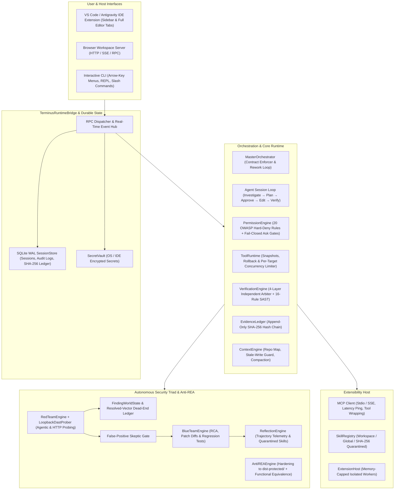
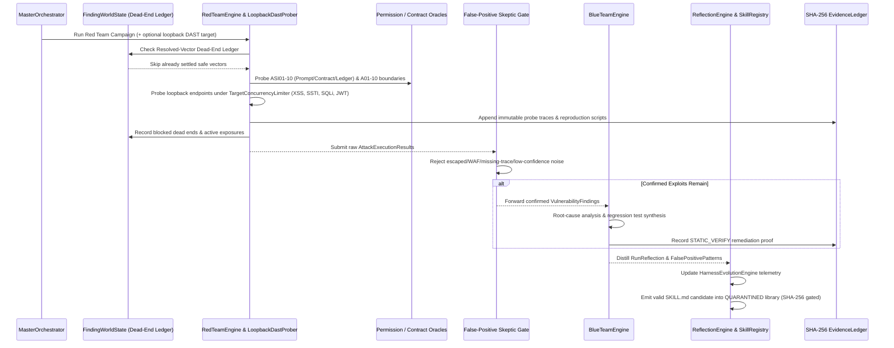

# TERMINUS

<p align="center">
  
</p>

<p align="center">
  <pre align="center">
  ┌──      ──┐  TERMINUS v0.4.0
  │   ████   │  Security-First Autonomous Software Engineering System
  │    ██    │  Red Team + DAST · Skeptic Gate · Blue Team · Anti-REA
  │    ██  ■ │  SHA-256 Evidence Ledger · Skills Studio · MCP · Plugin Host
  └──      ──┘
  </pre>
</p>

<p align="center">
  <strong>Where instructions become cryptographically verified, security-hardened software engineering.</strong>
</p>

<p align="center">
  <a href="#table-of-contents"></a>
  <a href="#table-of-contents"></a>
  <a href="#table-of-contents"></a>
  <a href="#table-of-contents"></a>
</p>

---

## Table of Contents

- [Overview](#overview)
- [System Architecture](#system-architecture)
- [Red Team ↔ Skeptic ↔ Blue Team ↔ Reflection Loop](#red-team--skeptic--blue-team--reflection-loop)
- [Anti-REA Release Protection (`packages/anti-rea`)](#anti-rea-release-protection-packagesanti-rea)
- [Graphical Workspace & IDE Extension](#graphical-workspace--ide-extension)
- [Multi-Agent Verified Orchestration](#multi-agent-verified-orchestration)
- [Ecosystem: Skills, MCP & Plugins](#ecosystem-skills-mcp--plugins)
- [Security & Zero-Trust Permission Gate](#security--zero-trust-permission-gate)
- [CLI Reference, Arrow-Key Menus & REPL](#cli-reference-arrow-key-menus--repl)
- [Quick Start & CLI Update](#quick-start--cli-update)
- [Test Suite & Build Verification](#test-suite--build-verification)
- [License](#license)

---

## Overview

**TERMINUS** is a Security-First Autonomous Software Engineering System engineered in strict TypeScript on Bun/Node. Beyond planning and editing code, TERMINUS continuously challenges its own runtime and generated applications through execution-grounded **Red Team campaigns**, **loopback HTTP DAST probes**, **False-Positive Skeptic validation**, **Blue Team patch & regression test synthesis**, **independent SHA-256 evidence verification**, and **Anti-REA binary/JS release hardening**.

### Core Engineering Principles

1. **Evidence Over Claims (Zero False Acceptance)**: Worker agents cannot self-certify completion. Final verdicts come exclusively from an independent verification engine auditing test outputs, static AST/SAST scans, and a hash-chained SHA-256 `EvidenceLedger`.
2. **Fail-Closed Zero-Trust Boundaries**: Destructive actions, out-of-bounds paths, interactive `ask` gates, and loopback DAST scopes fail closed by default — even in headless or non-TTY execution.
3. **Adversarial Self-Defense**: Every orchestration cycle can execute agentic boundary probes (OWASP Agentic Top 10 `ASI01`–`ASI10`) and application security probes (OWASP Top 10 `A01`–`A10` + localhost XSS/SSTI/SQLi/JWT DAST) filtered by a False-Positive Skeptic before Blue Team remediation runs.
4. **Source-Preserving Release Hardening**: Protected builds emit exclusively to `dist-protected/` and must pass functional equivalence verification before receiving a signed release manifest.
5. **Extensible Without Modifying Core**: Add capabilities via quarantined `SKILL.md` skills, stdio/SSE MCP connectors, and worker-isolated plugins communicating through the typed `TerminusRuntimeBridge`.

---

## System Architecture



### Package Architecture

| Package | Responsibility |
|---|---|
| [`apps/cli`](apps/cli) | CLI entrypoint, raw-mode arrow-key interactive selectors (`--skills`, `--mcp`, `--extensions`), REPL, and self-update check (`--update`) |
| [`apps/vscode`](apps/vscode) | Antigravity IDE & VS Code webview extension (`terminus.SidebarProvider` + full editor tabs + Activity Bar) |
| [`packages/workspace-ui`](packages/workspace-ui) | Responsive OLED dark monochrome webview UI (12 live-data screens, dropdown switcher + scrollable tab strip) |
| [`packages/runtime-bridge`](packages/runtime-bridge) | Typed RPC + SSE seam decoupling CLI/IDE clients from agent internals |
| [`packages/agent-runtime`](packages/agent-runtime) | `MasterOrchestrator`, `RedTeamEngine`, `LoopbackDastProber`, `FindingWorldState`, `BlueTeamEngine`, `ReflectionEngine`, `VerificationEngine`, `EvidenceLedger`, `HarnessEvolutionEngine` |
| [`packages/anti-rea`](packages/anti-rea) | Artifact classifier, AST/string hardening adapter, `AntiREAFunctionalVerifier`, and SHA-256 signed release manifest generator |
| [`packages/permission-engine`](packages/permission-engine) | Deterministic policy evaluator (20 hard-deny invariants, risk tiers, bash parser) |
| [`packages/tool-runtime`](packages/tool-runtime) | Workspace file/shell tools, pre-edit snapshots, secret redaction, and `TargetConcurrencyLimiter` |
| [`packages/context-engine`](packages/context-engine) | Repository mapper, evidence freshness guard, compaction, and `SkillRegistryManager` (with SHA-256 quarantine) |
| [`packages/mcp-client`](packages/mcp-client) | Stdio / SSE Model Context Protocol client with schema validation and untrusted output tagging |
| [`packages/extension-host`](packages/extension-host) | Isolated subprocess extension runner with memory caps and circuit breakers |
| [`packages/model-gateway`](packages/model-gateway) | Multi-provider streaming adapter (Nebius NVIDIA Nemotron, Anthropic Claude, OpenAI, Google Gemini, Ollama) |
| [`packages/session-store`](packages/session-store) | Durable SQLite WAL store for sessions, permission audits, and SHA-256 `evidence_records` |

---

## Red Team ↔ Skeptic ↔ Blue Team ↔ Reflection Loop

TERMINUS executes an execution-grounded offensive/defensive loop rather than relying on LLM self-reports:



### Capabilities Implemented in the Triad
1. **Execution-Grounded Agentic Boundary Probing (`ASI01`–`ASI10`)**: Exercises live `PermissionEngine`, `SpecialistAgentContract`, tamper-detection on `EvidenceLedger.verifyIntegrity()`, and unbacked-claim falsification on `VerificationEngine`.
2. **Native Loopback DAST Probing (`packages/agent-runtime/src/redteam/dast-prober.ts`)**:
   - **Fail-Closed Loopback Guard (`assertLoopbackTarget`)**: Unconditionally refuses non-loopback domains and external IPs.
   - **Reflected XSS**: Randomized nonces verified against `Content-Type` and HTML-escaping checks.
   - **SSTI**: Prime multiplication expressions (`7919*6841`) verified strictly for evaluated `54173879` output.
   - **SQLi**: Safe syntax probes checking database parser signatures (`SQLITE_ERROR`, Postgres/MySQL syntax markers, HTTP 5xx faults).
   - **JWT Analyzer**: Local `node:crypto` audit detecting `alg: none`, missing `exp`, and weak HMAC signing keys.
3. **Finding World State & Dead-End Ledger (`packages/agent-runtime/src/redteam/finding-graph.ts`)**: Tracks weighted exposure relationships (`findLowestCostAttackPath`) and caches settled blocked vectors (`matchResolvedVector`) across cycles.
4. **Keyed Per-Target Semaphore (`TargetConcurrencyLimiter`)**: Caps concurrent probes/commands per loopback host/port so parallel workers do not overload test servers.
5. **False-Positive Skeptic Gate**: Validates concrete execution traces, reproduction commands, confidence thresholds, and mitigated-response signatures before generating Blue Team diffs.
6. **Trajectory Reflection**: Updates `HarnessEvolutionEngine` telemetry and synthesizes defensive playbooks strictly into `~/.terminus/skills-imported` in **quarantined** trust state until human SHA-256 approval.

---

## Anti-REA Release Protection (`packages/anti-rea`)

TERMINUS includes an integrated Anti-Reverse Engineering Agent subsystem built for safe distribution:
- **Zero Source Mutation**: Original repository files remain untouched; hardened outputs are emitted exclusively to `dist-protected/`.
- **Format Classification**: Detects `.js`/`.mjs`/`.cjs`, `.ts`, `.wasm`, `.asar`, Python, and native binaries while stripping exposed `.map` references.
- **Hardening Pipeline**: Applies profile-based transforms (`standard`, `enhanced`, `maximum`, `research_lab`) including canary decoy weaving, string/header protection, and integrity seals.
- **Mandatory `AntiREAFunctionalVerifier`**: Validates artifact disk presence, startup execution checks, and test suite equivalence before emitting a SHA-256 `SignedReleaseManifest` (`dist-protected/release-manifest.json`).

---

## Graphical Workspace & IDE Extension

The webview & browser interface uses an **OLED black dark monochrome** aesthetic (`#000000` canvas, `#09090b`/`#121215`/`#18181b` surfaces, zero green/neon accents) powered by the official Terminal Frame mark.

```mermaid
flowchart LR
    subgraph NARROW["Narrow Sidebar Mode (< 760px)"]
        DD["Compact Section Dropdown + Scrollable Pill Bar"]
        CTL["Working Session Picker · Pause / Resume · Stop · Inspect"]
        FULL["⤢ Open Full Workspace Tab"]
    end

    subgraph VIEWS["12 Live-Data Screens (Zero Demo Mocks)"]
        W["Workspace & Approval Stream"]
        RT["Red Team Lab (+ Loopback DAST Input)"]
        BT["Blue Team Skeptic & Patch Console"]
        AR["Anti-REA Protection Studio"]
        AG["Specialist Agents & Contracts"]
        SK["Skills Studio (SHA-256 Quarantine)"]
        MC["MCP & Integrations"]
        EX["Isolated Plugin Host"]
        MO["Model Providers & Keys"]
        RU["Live Editable Rules (AGENTS.md / TERMINUS.md)"]
        SE["Permission Audit Log"]
        AN["Usage, Cost & Integrity Budgets"]
    end

    NARROW --> VIEWS
```



- **Pause / Resume & Stop Controls**: Wired directly to `TerminusRuntimeBridge` execution gates and `AbortController` handles to pause cleanly at boundaries or terminate runaway subprocesses.
- **Collapsible Task Inspector Drawer**: Displays SHA-256 ledger chains, unified diffs, DAG progress, and live repository maps without stealing sidebar width.

---

## Multi-Agent Verified Orchestration

| Specialist Harness | Responsibility | Filesystem Scope | Shell Policy | Self-Certify |
|---|---|---|---|---|
| **Primary Architect** | Task decomposition & DAG routing | Read-only | Sandboxed | ❌ Blocked |
| **Backend / Frontend Implementer** | Scoped code edits & pre-checks | Scoped / Workspace R/W | Sandboxed | ❌ Blocked |
| **Adversarial Verifier** | Independent test/build execution | Read-only | Test-only | ❌ Blocked |
| **Security Auditor / Red Team** | AST SAST, boundary probes & DAST | Read-only | Sandboxed | ❌ Blocked |
| **VerificationEngine** | Audits `EvidenceLedger` SHA-256 chain & verdicts | Internal arbiter | Internal | ✅ Authoritative |

---

## Ecosystem: Skills, MCP & Plugins

- **Skills Studio (`SKILL.md`)**: Discovers skills across `./skills`, `~/.terminus/skills`, and `~/.terminus/skills-imported`. External or distilled skills enter **quarantined** state until approved by SHA-256 hash (`terminus --approve-skill <name>` or via UI).
- **MCP Client**: Manages `stdio` and `sse` servers with ping latency telemetry, tool wrapping, and credential scrubbing.
- **Plugin Host**: Spawns isolated extension worker threads with hard memory boundaries and timeouts.

---

## Security & Zero-Trust Permission Gate

All model actions pass through [`PermissionEngine`](packages/permission-engine):
1. **20+ Hard-Deny Invariants**: Blocks SSH key access (`~/.ssh`, `id_rsa`, `id_ed25519`), destructive git flags (`push --force`, `reset --hard`), pipe-to-shell remote execution (`curl ... | sh`), and credential dumps.
2. **Interactive `ask` Approval Gates**: Pauses tool & orchestrator execution on medium/high-impact mutations and honors human rejections deterministically.
3. **Pre-Edit Snapshots & Stale-Write Guard**: Captures baseline buffers before modifying files so `/undo` or checkpoint restores preserve unrelated dirty edits.
4. **Durable SQLite Audit Trail**: Logs every tool permission decision, user approval, and SHA-256 `EvidenceRecord` to local SQLite WAL storage.

---

## CLI Reference, Arrow-Key Menus & REPL

```text
terminus [flags] [task]

Core Options:
  --mode <mode>        Execution mode: act (default), plan, orchestrate, audit, ask, auto
  --orchestrate        Execute task using verified multi-agent DAG orchestration
  --gui                Launch local web workspace GUI server (default port: 4190)
  --dir <path>         Target workspace directory (default: current directory)
  --provider <prov>    Model provider: nebius (default), anthropic, openai, gemini, ollama
  --model <name>       Override default model ID
  --verify <cmd>       Custom verification commands (comma-separated)
  --report json        Output structured JSON CompletionReport
  --yes, -y            Auto-approve low-impact prompts / confirm CLI update

Ecosystem & Interactive Arrow-Key Menus (↑ / ↓ + Enter):
  --skills             Browse skills library & approve quarantined skills interactively
  --approve-skill <s>  Verify and approve a quarantined skill by SHA-256
  --mcp                Browse MCP presets interactively & test live connections
  --test-mcp <name>    Measure MCP latency & list discovered tools
  --extensions         Inspect isolated plugins interactively

Diagnostics, Sessions & Upgrades:
  --doctor             Run Bun/Node runtime, Git, credential, and project checks
  --sessions           List recent sessions for current workspace
  --resume <id>        Resume session context from an earlier session ID
  --replay <id>        Replay durable events from a past session
  --harnesses          Inspect OO-Harness contracts and permission boundaries
  --debt               Scan workspace for technical debt shortcut comments
  --version, -v        Show v0.4.0 Terminal Frame banner & build info
  --update             Check latest npm version & show/apply CLI upgrade
  --help, -h           Display command help
```

Interactive REPL slash commands (`terminus` with no arguments): `/status`, `/skills`, `/mcp`, `/extensions`, `/models`, `/harnesses`, `/route <task>`, `/orchestrate`, `/plan`, `/diff`, `/undo`, `/review`, `/usage`, `/budget <n>`, `/compact`, `/doctor`, `/sessions`, `/debt`, `/clear`, `/quit`.

---

## Quick Start & CLI Update

### 1. Global Install

```bash
npm install -g terminus-agent
# or with Bun
bun install -g terminus-agent
```

### 2. Update Installed CLI (`terminus-agent`)

```bash
# Recommended global upgrade via npm
npm install -g terminus-agent@latest

# Or using npm update / Bun
npm update -g terminus-agent
bun add -g terminus-agent@latest

# Built-in version check & update helper
terminus --update
# Or run non-interactively with auto-confirm:
terminus --update --yes
```

### 3. Configure Provider Credentials

```bash
mkdir -p ~/.terminus && cat > ~/.terminus/.env <<'EOF'
NEBIUS_API_KEY=...       # Default NVIDIA Nemotron provider (tokenfactory.nebius.com)
TAVILY_API_KEY=tvly-...  # Optional deep cited web research
ANTHROPIC_API_KEY=...    # Optional Anthropic Claude provider
OPENAI_API_KEY=...       # Optional OpenAI provider
GEMINI_API_KEY=...       # Optional Google Gemini provider
EOF
```

### 4. Run Tasks & Workspace

```bash
# Verified coding task
terminus "add strict schema validation to the signup handler and write unit tests"

# Multi-agent orchestration
terminus --orchestrate "refactor authentication middleware and eliminate timing leaks"

# Launch OLED dark workspace GUI in browser
terminus --gui

# Start interactive REPL
terminus
```

### 5. Antigravity IDE / VS Code Extension Commands

Open the **TERMINUS** icon in the Activity Bar or run from the Command Palette (`Cmd + Shift + P` / `Ctrl + Shift + P`):
- `TERMINUS: Open Full Workspace Tab` (`Cmd + Shift + T` / `Ctrl + Shift + T`)
- `TERMINUS: New Coding Session`
- `TERMINUS: Stop Active Agent Execution`

---

## Test Suite & Build Verification

```bash
bun test            # 189 passing tests across 36 test files (828 assertions)
bun run typecheck   # tsc --noEmit (0 errors)
bun run lint        # Biome check (0 errors/warnings)
bun run dist        # Build CLI dist/terminus.js, worker-entry.js, and apps/vscode/dist/extension.js
```

---

## License

MIT © [Sairaj M. Nadaf](https://github.com/SairajMN)
