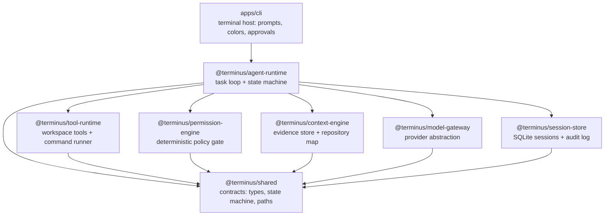
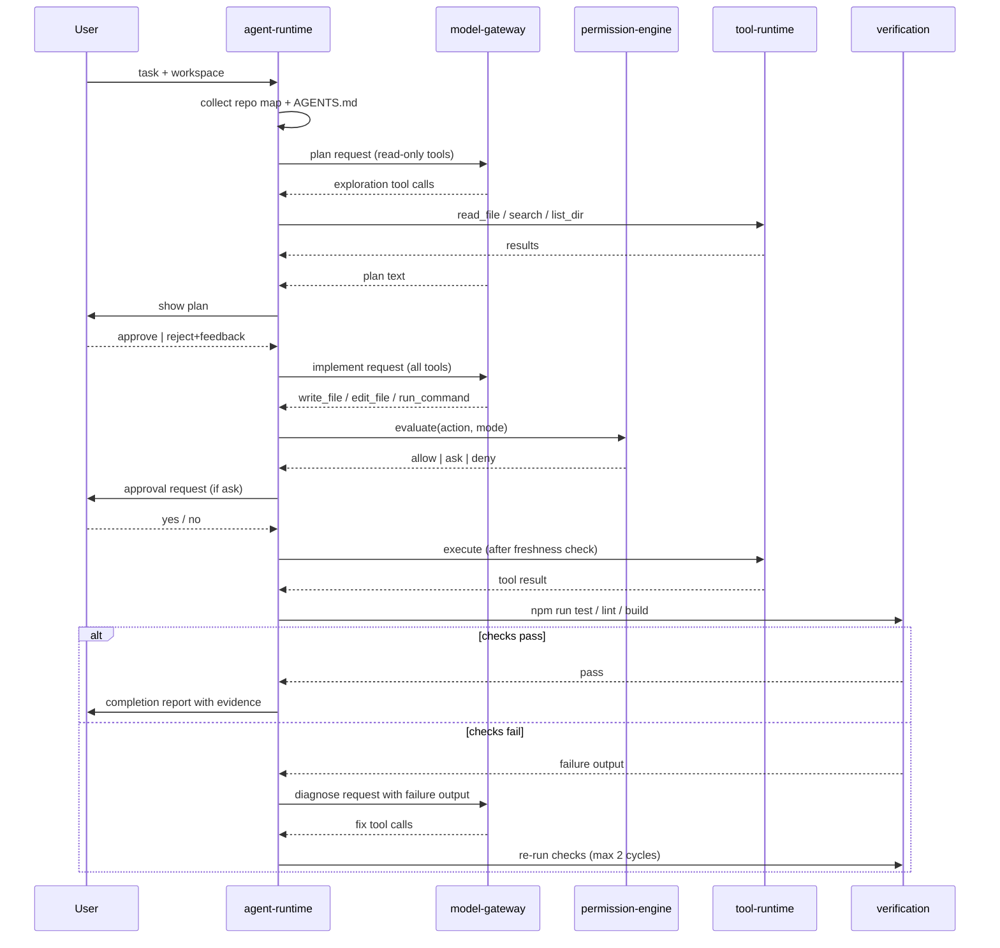
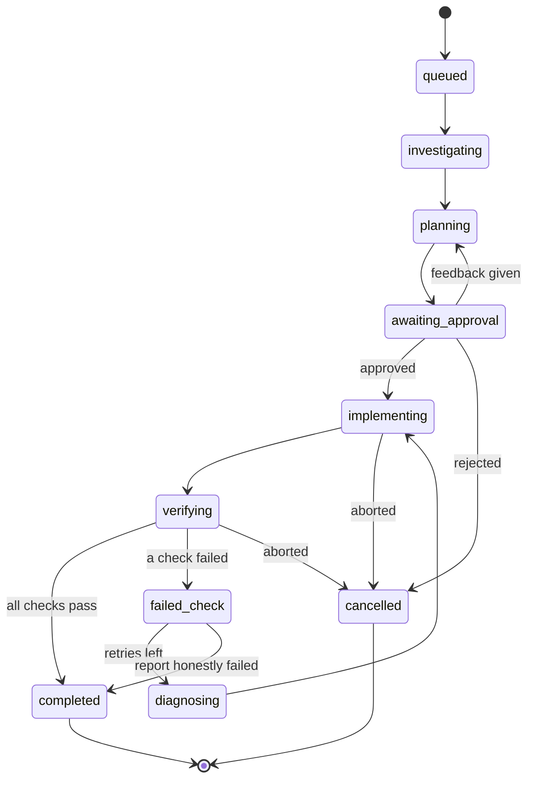
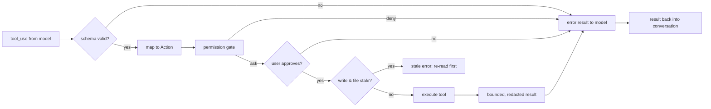
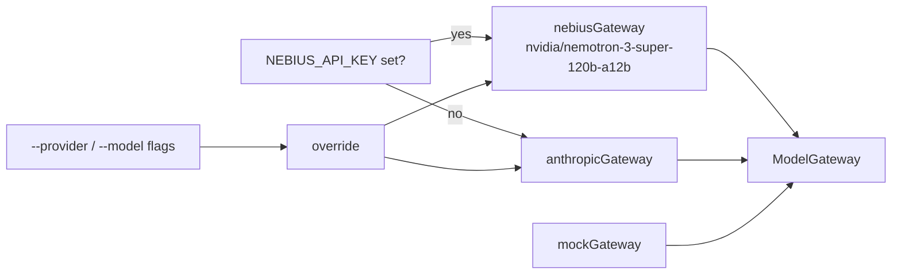
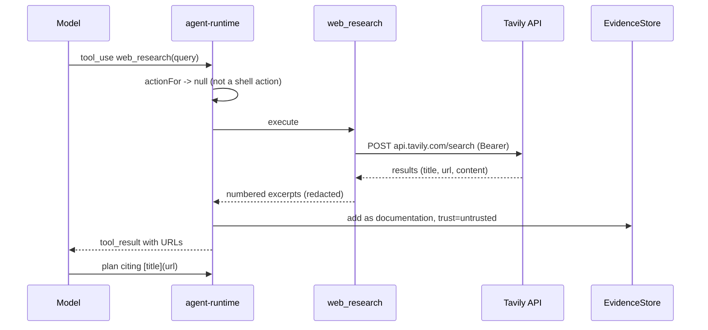

# Architecture

TERMINUS is a Bun/TypeScript monorepo. The agent runtime has no editor or UI
dependency; the CLI is one host among possible others. Every package has a
single responsibility and a one-way dependency edge.

## Package layering

Rules: `shared` depends on nothing above it; host apps depend on the runtime,
never the reverse; tools never know which model produced their input.

## The task loop

## State machine

Every task has exactly one state; transitions are validated, illegal jumps
throw. Persisted to the session store on every change.

## Tool execution pipeline

## Model gateway

`ModelGateway.complete(request, signal)` returns an async stream of `text`,
`tool_use`, and `usage` events. Providers implement the same interface:

- `nebiusGateway` — Nebius Token Factory (OpenAI-compatible) streaming with
  `tool_calls` argument-delta assembly; Nemotron models, 3 automatic retries.
- `anthropicGateway` — streaming Messages API with tool-use block assembly.
- `mockGateway` — scripted responses that record every request (snapshot);
  the end-to-end tests use it, so the full agent path runs without a network.

Selection is environment-driven via `selectGateway()`:

Adding another provider means implementing one function. Nothing else in the
runtime changes.

## Research flow (Tavily)

`web_research` is a read-tier tool: it is visible while planning, never maps
to a shell action, and its output is stored as **untrusted** evidence with
URLs preserved. The plan directive requires `[title](url)` citations for any
research used.

Search results are data: they never reach the permission engine and cannot
authorize a command.

## Contracts (`@terminus/shared`)

| Contract | Purpose |
|---|---|
| `ContextEvidence` | provenance-carrying context item: kind, source, hash, trust, staleness |
| `TaskState` / `TaskMachine` | validated task lifecycle |
| `ToolDefinition` | name, JSON-schema (zod), permission tier, bounded execution |
| `Action` | what the gate actually judges: command, file read, file write |
| `AgentEvent` | the only channel from runtime to any host UI |
| `CompletionReport` | outcome + changed files + commands + per-check results |

## Session persistence

`~/.terminus/terminus.db` (SQLite, WAL): one row per session (workspace, task,
state) and one append-only event log per session (tool decisions, approvals,
final report). Nothing about the workspace leaves the machine except the
scoped model requests described in [context engineering](context-engineering.md).

## Deliberate simplifications

- The repository map is a depth-3 tree plus manifest summaries — a tree index
  or embedding store can replace it behind `buildRepoMap` without touching the
  loop.
- Verification commands come from `package.json` scripts or `--verify`; other
  ecosystems can add detectors in `detectVerifications`.
- One agent, one workspace, sequential turns. Parallel specialist agents would
  sit above `runTask` and coordinate through the same event/report contracts.
