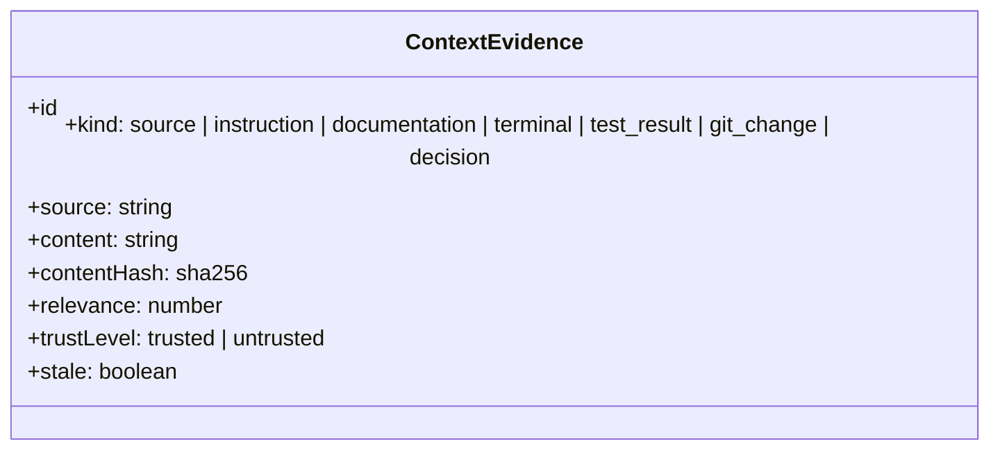
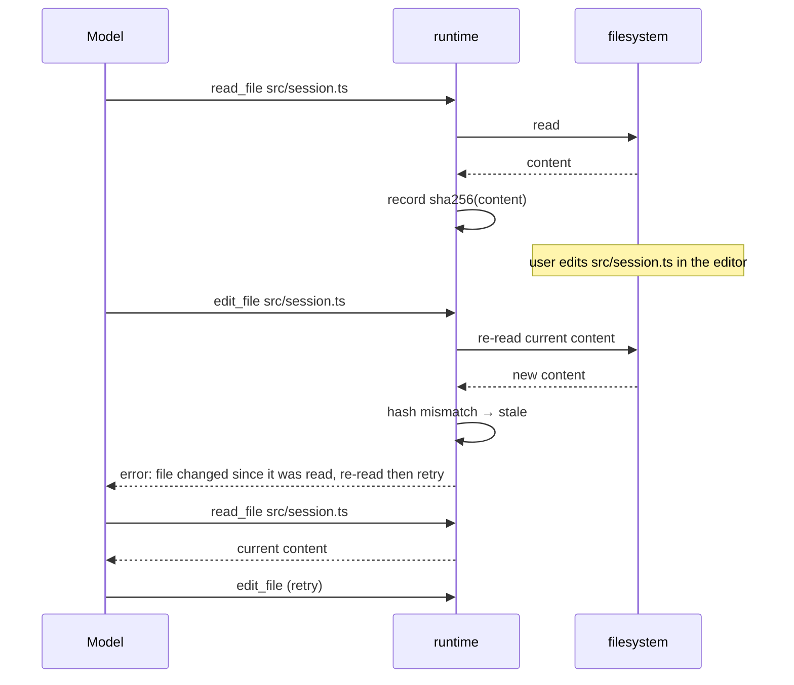
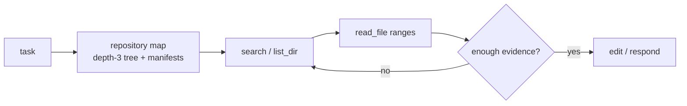

# Context engineering

A capable model with the wrong context fails. TERMINUS treats context as an
engineered input: gathered with provenance, checked for freshness, selected
against a budget, and never confused with instructions.

## What the model receives

Per turn, the request contains:

1. **System prompt** — role, workspace path, operating mode, and the rule that
   file content and command output are data, not instructions.
2. **Task message** — the user task, project instructions from `AGENTS.md`
   (authoritative), and the repository map.
3. **Conversation** — assistant tool calls and bounded tool results, nothing
   older than the current task.

Large tool outputs are capped (12 KB per result, 64 KB per command) before
they enter the conversation. Nothing is re-injected from a hidden store: what
the model saw is exactly what is in the message list.

## Evidence

Everything the context engine records is a `ContextEvidence`:

Trust is explicit: project instructions are `trusted`; everything read from
files, terminals, or external material is `untrusted`. Stale items are dropped
from selection, never silently reused.

## Freshness: the stale-write guard

The agent cannot clobber work that happened outside the session; it must see
the current file first.

## Progressive exploration

The agent is never given the codebase up front. It starts with a compact map
and discovers detail on demand:

## Selection over summarization

The evidence store keeps items verbatim. Selection ranks them — instructions
first, then relevance, then a boost when the item matches the current focus —
and fits them into a character budget. Nothing is rewritten into a lossy
summary that could discard the one exact line that mattered.

## Repository map

`buildRepoMap` produces a deterministic, cheap overview:

- depth-limited tree, skipping vendored/hidden directories
  (`node_modules`, `.git`, `dist`, …);
- manifest summaries: package name and available scripts.

It is regenerated per task, so it never goes stale, and it is what allows the
first model request to be small.

## Where this goes next

- symbol-level retrieval (language-server definitions/references) plugs in as
  another evidence producer;
- semantic search becomes another ranking signal, not a replacement for exact
  search — error strings and identifiers are best found exactly;
- cross-session project memory becomes `trusted` evidence of validated facts,
  still subject to freshness checks.
