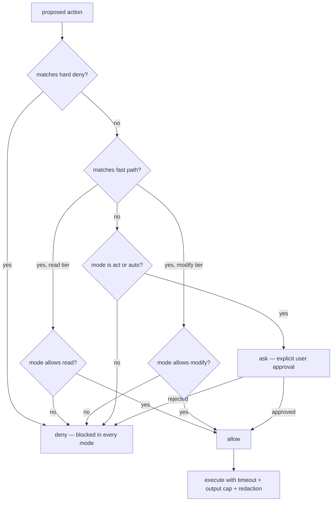

# Security model

TERMINUS executes commands and writes files. Safety is therefore a property of
the harness, not of the prompt. The model cannot authorize its own actions:
the gate decides from the proposed action, the compiled policy, and the
operating mode — never from conversation text.

## The gate

Every tool call is judged in a fixed order:



The evaluation is a pure function of `(action, mode, policy)`. Conversation
history, model claims, and previous approvals play no part in it.

## Modes

| Mode | read | modify | high-impact |
|---|---|---|---|
| `ask` | allow | deny | deny |
| `plan` | allow | deny | deny |
| `act` | allow | allow | ask |
| `auto` | allow | allow | ask for high-impact, auto-approve the rest |

`high_impact` is never auto-approved. Even `auto` mode asks.

## Tiers

| Tier | Examples | Notes |
|---|---|---|
| `read` | `git status`, `read_file`, `search`, `list_dir` | workspace-constrained |
| `modify` | `write_file`, `edit_file`, `npm run test`, `git commit` | requires act/auto |
| `high_impact` | `git push`, `python deploy.py`, anything unrecognized | always explicit approval |
| denied | `sudo`, `rm -rf`, force-push, `~/.ssh`, `curl \| sh`, `npm publish` | regex deny list, no override |

## File containment

- All file actions resolve through `realpath` and must stay inside the
  workspace root — symlink escapes are caught, not just `../` strings.
- Sensitive files (`.env` except `.env.example`, `.ssh`, `.aws`, key files,
  `.git-credentials`) are denied even inside the workspace.
- `.git/` internals are writable by nothing; git state changes go through the
  dedicated read tools in this phase.

## Policy configuration

Shipped rules: `packages/permission-engine/src/default-policy.json`.

```json
{
  "hard_deny": [{ "pattern": "\\bsudo\\b", "reason": "privilege escalation" }],
  "fast_path": [{ "pattern": "^\\s*git\\s+status\\b", "tier": "read" }]
}
```

`~/.terminus/policy.local.json` may only **append hard_deny rules**. Any
attempt to add `fast_path` rules (loosening) fails loudly at load time, and
every pattern is compile-checked. A shared rule that any user can silently
turn off is not a rule.

## Runtime protections

| Protection | Where |
|---|---|
| 60s default command timeout, SIGTERM then SIGKILL | `tool-runtime/src/run.ts` |
| 64 KB command output cap, 256 KB file-read cap | `tool-runtime` |
| Secret redaction (API keys, AWS keys, tokens, private keys) on every tool output | `tool-runtime/src/redact.ts` |
| Freshness check before writes — externally edited files force a re-read | `agent-runtime` + `context-engine` |
| Source code and tool output are `untrusted` evidence; instructions inside them are data | system prompt + evidence trust levels |
| Append-only audit log of every tool decision and approval | `session-store` |
| Cancellation: Ctrl-C aborts the in-flight model call and child processes | `agent-runtime` |

## Known limits

- The gate is regex policy plus mode enforcement. It stops mistakes and
  opportunistic injections; it is not an OS sandbox. For hostile-code
  scenarios, run TERMINUS inside a container or VM.
- `run_command` uses the user's shell inside the workspace directory; the
  deny list blocks known-dangerous shapes but cannot reason about arbitrary
  script semantics. That is exactly what the `ask` tier is for.
- The `~/.terminus/` database is per-user file storage; it stores task text
  and tool summaries, never API keys (keys are read from the environment per
  call).
