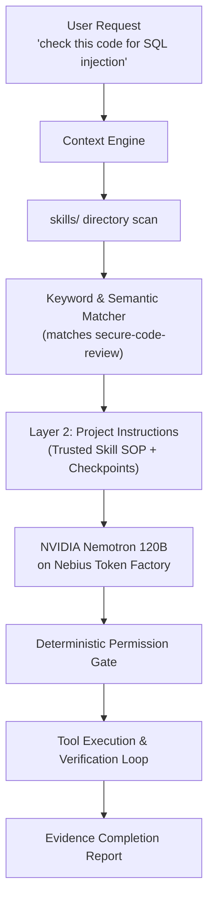

# TERMINUS Agent Skills — The Beginner's Guide

> **Learn how to supercharge your TERMINUS coding agent with specialized, production-grade engineering skills.**

---

## 1. What are Agent Skills?

When an AI coding agent operates on your repository, generic prompting often leads to shallow or inconsistent results. 

**Agent Skills** solve this problem. A skill is a standardized, modular Markdown document (`SKILL.md`) with YAML frontmatter that equips TERMINUS with **expert domain procedures (SOPs)**, vulnerability checklists, architectural heuristics, and concrete before/after code examples.

Instead of guessing how to audit code or build an interface, TERMINUS activates the exact skill required for the job and executes it step by step through its deterministic permission gate and verification loop.

---

## 2. Included Skills Catalog

TERMINUS comes equipped with battle-tested skills organized by engineering domain:

| Domain | Skill Name | What It Does | Trigger Keywords |
|---|---|---|---|
| **Security** | `secure-code-review` | Systematic OWASP Top 10 vulnerability scanner (SQL injection, XSS, SSRF, broken auth) with vulnerable vs fixed code and remediation priorities. | `security review`, `OWASP`, `vulnerability scan`, `audit`, `SQL injection`, `XSS`, `SSRF` |
| **Frontend** | `design-system-builder` | Extracts design tokens (colors, typography, radii, spacing) from mockups or screenshots into production-ready Tailwind CSS themes. | `design system`, `extract tokens`, `color palette`, `UI theme` |
| **Frontend** | `landing-page-scaffold` | Builds complete, conversion-optimized responsive landing pages following the proven 5-section framework (Hero → Social Proof → Features → Pricing → CTA). | `landing page`, `marketing page`, `scaffold landing`, `pricing section` |
| **Frontend** | `tasteful-ui` | Enforces refined visual hierarchy, anti-generic color pairings, accessible contrast (WCAG AA), and smooth micro-interactions. | `polish UI`, `tasteful design`, `improve aesthetics`, `fix hierarchy` |
| **Backend** | `api-shape-explorer` | Applies "Design It Twice": explores 3 radical shapes (functional, class, fluent) for any module and compares ergonomics before writing code. | `design API`, `api shape`, `design it twice`, `interface options` |
| **Backend** | `route-to-openapi` | Scans route handlers (Express, FastAPI, Next.js) and validation schemas (Zod, Pydantic) to generate OpenAPI 3.0 specs. | `generate openapi`, `swagger spec`, `api docs from code` |
| **Meta** | `skill-builder` | Meta-skill that guides you or the agent to create, test, and audit brand-new custom skills from natural language or documentation. | `create a skill`, `author skill`, `make a skill`, `skill builder` |

---

## 3. How to Use Skills (Step-by-Step)

You do **not** need to manually copy-paste prompt templates. TERMINUS automatically discovers and loads skills!

### Scenario A: Running a Full Security Code Audit
To perform a complete OWASP Top 10 security review on your codebase without modifying any files:

```bash
# Audit mode: reads broadly, changes nothing, outputs severity-ranked report
terminus --mode audit "run a full OWASP Top 10 security review on src/auth/"
```

**What TERMINUS does:**
1. Matches the `secure-code-review` skill.
2. Evaluates all 10 OWASP categories (A01 through A10) sequentially.
3. Labels each finding as **High**, **Medium**, or **Low** severity.
4. Provides ready-to-use remediation code blocks referencing exact `file:line` locations.

---

### Scenario B: Generating an API and Exploring Interface Shapes
Before implementing a new payment or database service, ask TERMINUS to explore shapes:

```bash
terminus --mode plan "explore API shapes for the user subscription billing service"
```

**What TERMINUS does:**
1. Activates `api-shape-explorer`.
2. Produces 3 competing designs: Functional (pure), Object-Oriented (stateful), and Fluent Builder (composable).
3. Rates each on type safety, testability, failure modes, and ergonomics.
4. Waits for your approval before writing any implementation code.

---

### Scenario C: Scaffolding a Modern Landing Page
To generate a responsive landing page prototype:

```bash
terminus --mode act "use landing-page-scaffold to build a landing page for TERMINUS with hero, benchmark proof, and pricing"
```

**What TERMINUS does:**
1. Activates `landing-page-scaffold` and `tasteful-ui`.
2. Generates semantic HTML, Tailwind tokens, and responsive layout.
3. Runs project checks (`npm test`, build verification).
4. Verifies zero layout issues and reports completion with exact file diffs.

---

## 4. How Skills Work Under the Hood



1. **Discovery**: On startup, TERMINUS scans `skills/**/SKILL.md` in your repository or `~/.terminus/skills/`.
2. **Matching**: The Context Engine matches prompt keywords against skill names and trigger descriptions.
3. **Instruction Injection**: The matched skill's SOP, checklists, and code examples are injected as **Trusted Layer 2 Instructions** in the prompt.
4. **Execution & Proof**: Nemotron follows the exact SOP, runs verification checks, and outputs the structured report.

---

## 5. How to Create Your Own Custom Skill

Creating a custom skill for your team or project takes less than 3 minutes.

### Step 1: Create the Skill Directory
Create a folder inside `skills/<category>/<skill-name>/`:

```bash
mkdir -p skills/database/postgres-migration-advisor
```

### Step 2: Create `SKILL.md` with YAML Frontmatter
Create `skills/database/postgres-migration-advisor/SKILL.md`:

```markdown
---
name: postgres-migration-advisor
description: "Reviews and drafts zero-downtime PostgreSQL migrations, checking for lock contention, missing indexes, and schema compatibility. Trigger when users ask about database migrations, altering tables, or adding indexes."
license: MIT
---

# PostgreSQL Zero-Downtime Migration SOP

## Checkpoints
- [ ] Are new columns with default values using `DEFAULT ...` safely without full table rewrites?
- [ ] Are indexes created using `CREATE INDEX CONCURRENTLY`?
- [ ] Are foreign key constraints validated separately to prevent long exclusive table locks?

## Examples
### ❌ Dangerous Migration
```sql
ALTER TABLE users ADD COLUMN bio text DEFAULT 'new user';
CREATE INDEX idx_users_email ON users(email);
```

### ✅ Safe Zero-Downtime Migration
```sql
ALTER TABLE users ADD COLUMN bio text;
ALTER TABLE users ALTER COLUMN bio SET DEFAULT 'new user';
CREATE INDEX CONCURRENTLY idx_users_email ON users(email);
```
```

### Step 3: Run TERMINUS
TERMINUS immediately discovers the new skill:
```bash
terminus --mode plan "add a migration to add status column to orders table"
```
It will automatically apply your zero-downtime checkpoints!
